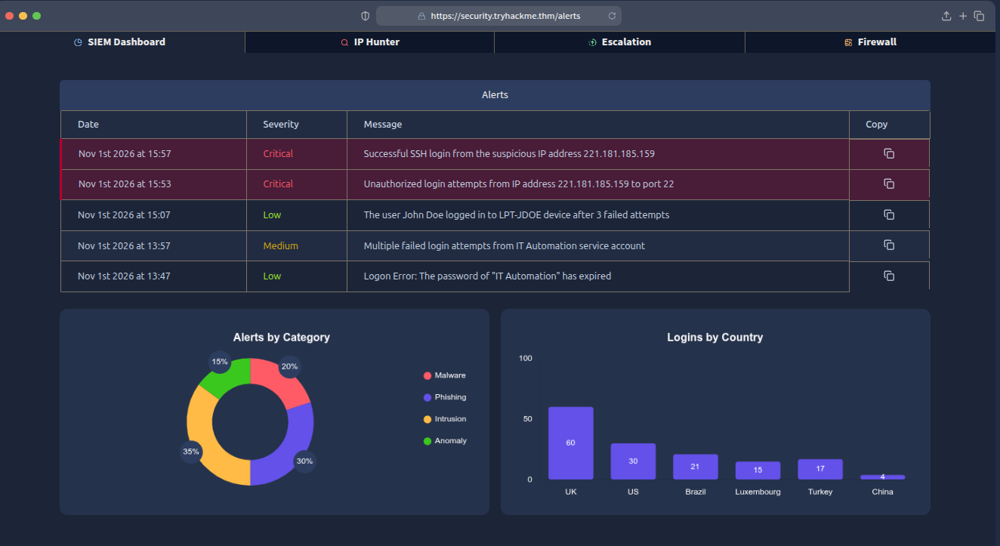
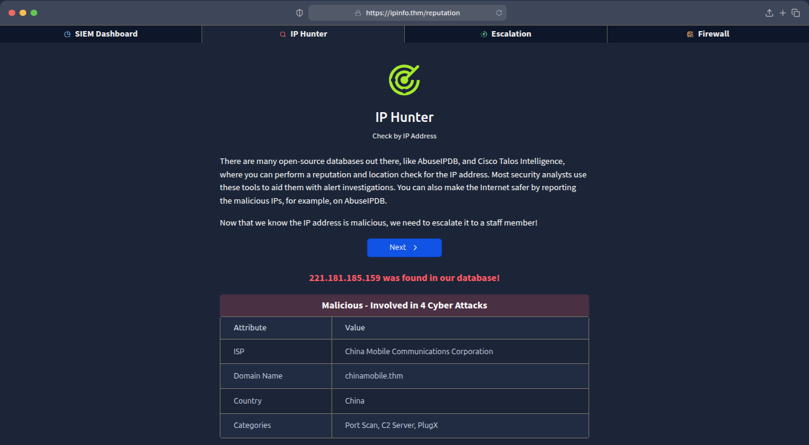
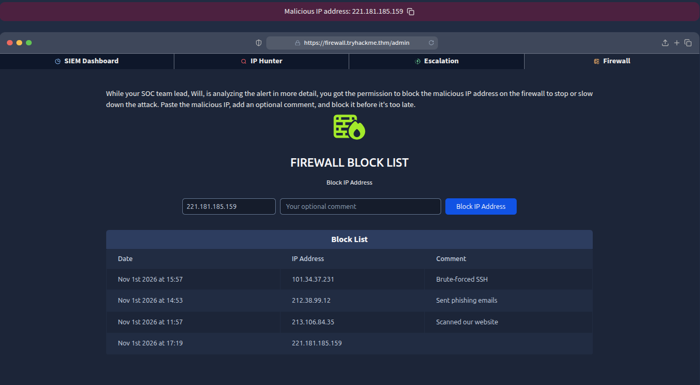
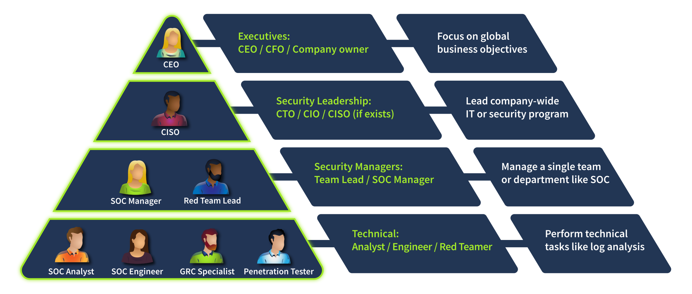
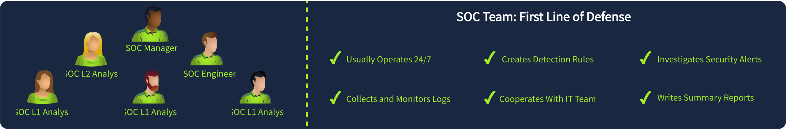
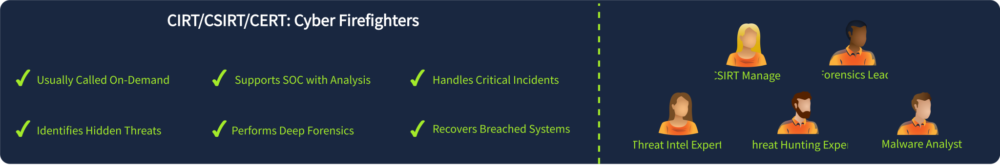

# SOC Tier 1

##  GIỚI THIỆU

Security Operations Center (SOC) là trung tâm giám sát và điều hành an ninh mạng, đóng vai trò quan trọng trong việc bảo vệ hệ thống thông tin của các tổ chức.

SOC Analyst Tier 1 là tuyến phòng thủ đầu tiên, chịu trách nhiệm giám sát hệ thống, phân tích nhật ký, phát hiện các hoạt động đáng ngờ, phân loại cảnh báo và hỗ trợ ứng cứu các sự cố an ninh mạng.

Lộ trình bao gồm quy trình vận hành SOC, sử dụng các công cụ giám sát, phân tích lưu lượng mạng, phát hiện tấn công và xử lý sự cố.

## MỤC TIÊU HỌC TẬP

- Hiểu cấu trúc, vai trò và quy trình vận hành của SOC.
- Nắm vững quy trình tiếp nhận, phân loại, phân tích và xử lý cảnh báo bảo mật.
- Sử dụng các công cụ SOC như SIEM, EDR, SOAR và IDS.
- Phân tích lưu lượng mạng để phát hiện các dấu hiệu tấn công.
- Giám sát và phát hiện các cuộc tấn công vào hệ thống web.
- Phân tích nhật ký và phát hiện mối đe dọa trên Windows và Linux.
- Nhận diện, phân tích email phishing và các kỹ thuật tấn công phổ biến.
- Áp dụng các framework như MITRE ATT&CK, Cyber Kill Chain và Pyramid of Pain.
- Sử dụng Threat Intelligence phục vụ điều tra và phân tích sự cố.
- Phát triển tư duy phân tích, điều tra và ứng cứu sự cố an ninh mạng.

---

## TỔNG QUAN LỘ TRÌNH

| Section | Module | Số Room |
|:---:|---|:---:|
| 01 | [Blue Team Introduction](#section-01--blue-team-introduction) | 4 |
| 02 | SOC Team Internals | 5 |
| 03 | Core SOC Solutions | 5 |
| 04 | Cyber Defence Frameworks | 6 |
| 05 | Phishing Analysis | 7 |
| 06 | Network Traffic Analysis | 5 |
| 07 | Network Security Monitoring | 6 |
| 08 | Web Security Monitoring | 4 |
| 09 | Windows Security Monitoring | 4 |
| 10 | Linux Security Monitoring | 4 |
| 11 | Malware Concepts for SOC | 4 |
| 12 | Threat Analysis Tools | 4 |
| 13 | SIEM Triage for SOC | 5 |
| 14 | SOC Level 1 Capstone Challenges | 4 |
| **Tổng** | **14 Module** | **67 Room** |

---

## SECTION 01 – BLUE TEAM INTRODUCTION

### Giới thiệu

Giới thiệu những kiến thức cơ bản về Blue Team, vai trò của SOC Analyst và các phương thức mà kẻ tấn công có thể khai thác con người hoặc hệ thống để xâm nhập vào tổ chức.

### Danh sách bài học

- [ ] 01. [Junior Security Analyst Intro](#01-junior-security-analyst-intro)
- [ ] 02. [SOC Role in Blue Team](#02-soc-role-in-blue-team)
- [ ] 03. Humans as Attack Vectors
- [ ] 04. Systems as Attack Vectors

### Kiến thức trọng tâm

- Khái niệm và nhiệm vụ của Blue Team.
- Vai trò và trách nhiệm của SOC Analyst.
- Cấu trúc tổ chức và các cấp độ trong SOC.
- Các kỹ thuật tấn công khai thác yếu tố con người.
- Các phương thức tấn công vào hệ thống thông tin.
- Vai trò của giám sát và phát hiện sớm các mối đe dọa.

### 01. Junior Security Analyst Intro

#### Task 1 - Junior Security Analyst Journey

Một chuyên viên SOC Tier 1 sẽ làm việc trong một nhóm SOC 24/7:
- Theo dõi và kiểm tra các cảnh báo an ninh mạng.
- Tham gia thảo luận và các hội thảo về SOC.
- Hợp tác với các nhóm bảo mật khác trong công ty.
- Liên tục cập nhật và phân tích các phương pháp tấn công và phòng thủ mới.

#### Task 3 - A Day in the Life of a Security Analyst

- Ta có một dashboard như sau:



**Câu hỏi 1: Địa chỉ IP độc hại trong các cảnh báo là gì?**
Đáp án:

```bash
221.181.185.159`
```

- Dựa vào thông tin trong cơ sở dữ liệu chúng ta có thể biết được các thông tin từ địa chỉ IP độc hại này:



**Câu hỏi 2: Bạn sẽ báo cáo cảnh báo về địa chỉ IP độc hại cho ai?**

Đáp án:

```bash
SOC Team Lead
```


**Câu hỏi 3: Bạn nhận được thông báo gì sau khi chặn địa chỉ IP trên tường lửa?**

Chúng ta tiến hành block IP độc hại



### 02. SOC Role in Blue Team

#### Task 1 - Introduction

Trong bài học này chúng ta sẽ tìm hiểu về:
- Khái niệm và mục đích của Blue Team.
- Vị trí của SOC trong cấu trúc công ty.
- Lộ trình của chuyên viên SOC Tier 1.

#### Task 2 - Security Hierarchy

**Hệ thống phân cấp bảo mật**

- Mỗi công ty đều có sự ưu tiên khác nhau về an ninh mạng. Vì vậy mỗi công ty sẽ có phương pháp bảo mật và cấu trúc đội ngũ an ninh mạng khác nhau.
- Chúng ta cùng xem xét một ví dụ:



- Nhìn vào sơ đồ trên, các nhà điều hành cấp cao như CEO thường tập trung vào các mục tiêu kinh doanh toàn cầu và không quản lý các khía cạnh kỹ thuật. Đó là lý do tại sao họ thuê một Giám đốc An ninh Thông tin (CISO) hoặc một vị trí tương đương, người hiểu rõ nhu cầu kinh doanh và có thể tạo ra các bộ phận an ninh phù hợp nhất.

**Bộ phận an ninh**

- Giám đốc An ninh Thông tin (CISO) sẽ quản lý nhiều nhóm bảo mật khác nhau:
    + Red Team: Các chuyên gia bảo mật tấn công, chuyên gia kiểm thử xâm nhập (Pentester) hoặc hacker mũ trắng (Ethical Hacker), có nhiệm vụ tìm kiếm và phát hiện các lỗ hổng, điểm yếu bảo mật trong hệ thống.
    + GRC Team: Các chuyên gia quản lý chính sách và đảm bảo tuân thủ các quy định như PCI DSS.
    + Blue Team: Các chuyên gia an ninh phòng thủ như chuyên viên phân tích SOC, kỹ sư hoặc người ứng phó sự cố.

**Câu hỏi 1: Vai trò cấp cao nào thường đưa ra các quyết định quan trọng về an ninh mạng?**

Đáp án:
```
CISO
```

**Câu hỏi 2: Tên gọi thông dụng cho các vị trí như chuyên viên phân tích và kỹ sư SOC là gì?**

Đáp án:
```
Blue Team
```

#### Task 3 - Meet the Blue Team

- Blue Team tập trung vào bảo mật phòng thủ. Liên tục giám sát các cuộc tấn công và phản ứng nhanh chóng khi có sự cố an ninh mạng.

**Security Operations Center (SOC)**



- Những người làm việc trong SOC là tuyến phòng thủ đầu tiên, xử lý các cảnh báo, giải quyết hầu hết các cuộc tấn công.

- Một SOC thông thường bao gồm:
    - L1 Analysts: Hay còn gọi là SOC Tier 1 có trách nhiệm phân loại cảnh báo và chuyển các trường hợp phức tạp cho SOC Tier 2.
    - L2 Analysts: Hay còn gọi là SOC Tier 2 thực hiện điều tra các trường hợp phức tạp do SOC Tier 1 đưa lên.
    - Engineers: Là những người thực hiện cấu hình các công cụ bảo mật như EDR hoặc SIEM.
    - Manager: Người quản lý toàn bộ SOC.

**Cyber Incident Response Team (CIRT)**
>Đội ứng phó sự cố an ninh mạng



- Nếu như SOC không thể giải quyết được các sự cố an ninh mạng, chúng ta sẽ cần đến CIRT.

**Specialized Defensive Roles**
> Các vai trò phòng thủ chuyên biệt


- Digital Forensics Analyst: Điều tra các mối đe dọa tiềm ẩn.
- Digital Forensics Analyst: Thu thập các thông tin về các mối đe dọa.
- AppSec Engineer: Duy trì phần mềm an toàn.
- AI Researcher: Nghiên cứu các mối đe dọa từ AI và cách phòng chống chúng.

**Câu hỏi 1: Blue Team tập trung vào defensive hay offensive?**

Đáp án:
```
defensive
```

**Câu hỏi 2: Bộ phận nào xử lý các sự cố an ninh mạng đang diễn ra hoặc khẩn cấp?**

Đáp án:
```
CIRT
```

---

## SECTION 02 – SOC TEAM INTERNALS

### Giới thiệu

Tìm hiểu các hoạt động nội bộ của SOC, bao gồm quy trình tiếp nhận và xử lý cảnh báo, xây dựng báo cáo, sử dụng tài liệu hỗ trợ điều tra và đánh giá hiệu quả hoạt động của SOC.

### Danh sách bài học

- [ ] 01. SOC L1 Alert Triage
- [ ] 02. SOC L1 Alert Reporting
- [ ] 03. SOC Workbooks and Lookups
- [ ] 04. SOC Metrics and Objectives
- [ ] 05. Introduction to Phishing (Scenario)

### Kiến thức trọng tâm

- Quy trình phân loại và ưu tiên cảnh báo (Alert Triage).
- Phân biệt True Positive, False Positive, True Negative và False Negative.
- Thu thập thông tin và xác minh cảnh báo.
- Xây dựng báo cáo phân tích sự cố.
- Sử dụng SOC Workbook, Playbook và các nguồn tra cứu.
- Các chỉ số đánh giá hiệu quả hoạt động SOC.
- Quy trình chuyển cấp và phối hợp xử lý sự cố (Escalation).
- Nhận diện các dấu hiệu cơ bản của phishing.

---

## SECTION 03 – CORE SOC SOLUTIONS

### Giới thiệu

Tìm hiểu những công nghệ và giải pháp cốt lõi được sử dụng trong SOC để thu thập dữ liệu, giám sát hệ thống, phát hiện mối đe dọa và tự động hóa quy trình xử lý sự cố.

### Danh sách bài học

- [ ] 01. Introduction to EDR
- [ ] 02. Introduction to SIEM
- [ ] 03. Splunk: The Basics
- [ ] 04. Elastic Stack: The Basics
- [ ] 05. Introduction to SOAR

### Kiến thức trọng tâm

- Endpoint Detection and Response (EDR).
- Security Information and Event Management (SIEM).
- Security Orchestration, Automation and Response (SOAR).
- Cơ chế thu thập, chuẩn hóa và lưu trữ nhật ký.
- Tìm kiếm và phân tích dữ liệu bằng Splunk.
- Các thành phần của Elastic Stack.
- Xây dựng truy vấn phục vụ phân tích sự kiện bảo mật.
- Tự động hóa quy trình phát hiện và ứng cứu sự cố.

---

## SECTION 04 – CYBER DEFENCE FRAMEWORKS

### Giới thiệu

Tìm hiểu các mô hình và framework được sử dụng để mô tả hành vi của kẻ tấn công, phân tích các giai đoạn của một cuộc tấn công và hỗ trợ xây dựng chiến lược phát hiện, phòng thủ.

### Danh sách bài học

- [ ] 01. Pyramid Of Pain
- [ ] 02. Cyber Kill Chain
- [ ] 03. Unified Kill Chain
- [ ] 04. MITRE
- [ ] 05. Summit
- [ ] 06. Eviction

### Kiến thức trọng tâm

- Mô hình Pyramid of Pain.
- Các giai đoạn trong Cyber Kill Chain.
- Mô hình Unified Kill Chain.
- MITRE ATT&CK Framework.
- Chiến thuật, kỹ thuật và thủ tục tấn công (TTPs).
- Indicators of Compromise (IoCs).
- Phân tích chuỗi hành vi tấn công.
- Ứng dụng các framework trong điều tra và phát hiện mối đe dọa.

---

## SECTION 05 – PHISHING ANALYSIS

### Giới thiệu

Tìm hiểu các hình thức tấn công phishing, phương pháp phân tích email độc hại, kiểm tra các thành phần của email và sử dụng công cụ để xác định những dấu hiệu lừa đảo.

### Danh sách bài học

- [ ] 01. Phishing Analysis Fundamentals
- [ ] 02. Phishing Emails in Action
- [ ] 03. Phishing Analysis Tools
- [ ] 04. Phishing Prevention
- [ ] 05. The Greenholt Phish
- [ ] 06. Snapped Phish-ing Line
- [ ] 07. Phishing Unfolding (Scenario)

### Kiến thức trọng tâm

- Khái niệm và các hình thức phishing.
- Phân tích cấu trúc email và Email Header.
- Kiểm tra địa chỉ người gửi và các trường thông tin.
- Các cơ chế xác thực SPF, DKIM và DMARC.
- Phân tích đường dẫn URL và tên miền đáng ngờ.
- Kiểm tra tệp đính kèm độc hại.
- Sử dụng công cụ và nguồn Threat Intelligence để phân tích email.
- Xây dựng quy trình phát hiện và xử lý phishing.
- Các biện pháp phòng chống tấn công lừa đảo qua email.

---

## SECTION 06 – NETWORK TRAFFIC ANALYSIS

### Giới thiệu

Tìm hiểu các phương pháp thu thập và phân tích lưu lượng mạng nhằm xác định hoạt động bất thường, phát hiện dấu hiệu tấn công và hỗ trợ điều tra sự cố an ninh mạng.

### Danh sách bài học

- [ ] 01. Network Traffic Basics
- [ ] 02. Wireshark: The Basics
- [ ] 03. Wireshark: Packet Operations
- [ ] 04. Wireshark: Traffic Analysis
- [ ] 05. NetworkMiner

### Kiến thức trọng tâm

- Nguyên lý truyền dữ liệu trong mạng máy tính.
- Cấu trúc và thành phần của gói tin.
- Phân tích lưu lượng TCP, UDP, DNS và HTTP.
- Thu thập gói tin bằng Wireshark.
- Sử dụng Capture Filter và Display Filter.
- Phân tích luồng TCP và các phiên giao tiếp.
- Phát hiện hành vi bất thường trong lưu lượng mạng.
- Trích xuất thông tin và tệp từ PCAP.
- Sử dụng NetworkMiner trong phân tích lưu lượng.

---

## SECTION 07 – NETWORK SECURITY MONITORING

### Giới thiệu

Tìm hiểu các kỹ thuật giám sát an ninh mạng nhằm phát hiện các hoạt động trinh sát, đánh cắp dữ liệu, tấn công Man-in-the-Middle và những hành vi đáng ngờ trong hệ thống mạng.

### Danh sách bài học

- [ ] 01. Network Security Essentials
- [ ] 02. Network Discovery Detection
- [ ] 03. Data Exfiltration Detection
- [ ] 04. Man-in-the-Middle Detection
- [ ] 05. IDS Fundamentals
- [ ] 06. Snort

### Kiến thức trọng tâm

- Nguyên tắc giám sát an ninh mạng.
- Phát hiện hành vi quét mạng và trinh sát.
- Phát hiện hành vi dò quét cổng.
- Nhận diện hoạt động đánh cắp và truyền dữ liệu trái phép.
- Phát hiện tấn công Man-in-the-Middle.
- Các dấu hiệu ARP Spoofing và những hành vi mạng bất thường.
- Khái niệm và cơ chế hoạt động của IDS/IPS.
- Phân biệt Network IDS và Host IDS.
- Sử dụng Snort để phân tích và phát hiện tấn công.
- Phân tích cảnh báo từ hệ thống giám sát mạng.

---

## SECTION 08 – WEB SECURITY MONITORING

### Giới thiệu

Tìm hiểu các phương pháp giám sát và phân tích nhật ký web nhằm phát hiện những cuộc tấn công phổ biến vào ứng dụng web, mã độc Web Shell và các hoạt động từ chối dịch vụ.

### Danh sách bài học

- [ ] 01. Web Security Essentials
- [ ] 02. Detecting Web Attacks
- [ ] 03. Detecting Web Shells
- [ ] 04. Detecting Web DDoS

### Kiến thức trọng tâm

- Kiến trúc và nguyên lý hoạt động của ứng dụng web.
- Cấu trúc HTTP Request và HTTP Response.
- Phân tích Web Server Access Log và Error Log.
- Phát hiện SQL Injection.
- Phát hiện Cross-Site Scripting (XSS).
- Phát hiện các hành vi khai thác lỗ hổng web.
- Nhận diện và phân tích Web Shell.
- Phát hiện các dấu hiệu tấn công DDoS.
- Xây dựng quy tắc phát hiện tấn công web.
- Phân tích các hành vi bất thường trong nhật ký truy cập.

---

## SECTION 09 – WINDOWS SECURITY MONITORING

### Giới thiệu

Tìm hiểu hệ thống ghi nhật ký trên Windows và các kỹ thuật giám sát, phân tích sự kiện nhằm phát hiện hành vi đáng ngờ, hoạt động xâm nhập và những cuộc tấn công vào hệ điều hành Windows.

### Danh sách bài học

- [ ] 01. Windows Logging for SOC
- [ ] 02. Windows Threat Detection 1
- [ ] 03. Windows Threat Detection 2
- [ ] 04. Windows Threat Detection 3

### Kiến thức trọng tâm

- Cơ chế ghi nhật ký của Windows.
- Windows Event Viewer.
- Windows Security Event Log.
- Windows Event ID và ý nghĩa của các sự kiện bảo mật.
- Sysmon và khả năng giám sát hoạt động hệ thống.
- Phát hiện đăng nhập bất thường.
- Phân tích tiến trình và dòng lệnh thực thi.
- Phát hiện hành vi sử dụng PowerShell đáng ngờ.
- Giám sát thay đổi tài khoản và quyền truy cập.
- Phát hiện các hành vi leo thang đặc quyền.
- Phân tích chuỗi sự kiện và xây dựng timeline điều tra.

---

## SECTION 10 – LINUX SECURITY MONITORING

### Giới thiệu

Tìm hiểu cơ chế ghi nhật ký của Linux và cách phân tích các sự kiện hệ thống nhằm phát hiện những hành vi tấn công, truy cập trái phép và hoạt động bất thường trên máy chủ Linux.

### Danh sách bài học

- [ ] 01. Linux Logging for SOC
- [ ] 02. Linux Threat Detection 1
- [ ] 03. Linux Threat Detection 2
- [ ] 04. Linux Threat Detection 3

### Kiến thức trọng tâm

- Cơ chế ghi nhật ký trong Linux.
- Các tệp nhật ký hệ thống tại `/var/log`.
- Syslog và Journald.
- Auditd và hệ thống Linux Audit.
- Phân tích sự kiện đăng nhập SSH.
- Phát hiện hành vi Brute Force.
- Giám sát hoạt động của người dùng và tiến trình.
- Phát hiện lệnh thực thi đáng ngờ.
- Phát hiện hành vi leo thang đặc quyền.
- Phân tích các dấu hiệu Reverse Shell.
- Phát hiện những thay đổi bất thường trong hệ thống.

---

## SECTION 11 – MALWARE CONCEPTS FOR SOC

### Giới thiệu

Tìm hiểu những kiến thức cơ bản về mã độc, phương pháp phân loại và phân tích malware, đồng thời nhận diện các kỹ thuật mà kẻ tấn công sử dụng để khai thác những công cụ hợp pháp có sẵn trên hệ thống.

### Danh sách bài học

- [ ] 01. Malware Classification
- [ ] 02. Intro to Malware Analysis
- [ ] 03. Living Off the Land Attacks
- [ ] 04. Shadow Trace

### Kiến thức trọng tâm

- Khái niệm và phân loại mã độc.
- Virus, Worm, Trojan và Ransomware.
- Các phương pháp phân tích malware.
- Phân tích tĩnh (Static Analysis).
- Phân tích động (Dynamic Analysis).
- Nhận diện các hành vi đặc trưng của mã độc.
- Living Off the Land (LotL).
- Lạm dụng công cụ hệ thống hợp pháp để thực hiện tấn công.
- Phân tích dấu hiệu mã độc thông qua nhật ký và hành vi tiến trình.
- Xây dựng các chỉ dấu phục vụ phát hiện và điều tra.

---

## SECTION 12 – THREAT ANALYSIS TOOLS

### Giới thiệu

Tìm hiểu Cyber Threat Intelligence và các công cụ hỗ trợ phân tích, tra cứu, xác minh những chỉ dấu liên quan đến các mối đe dọa an ninh mạng.

### Danh sách bài học

- [ ] 01. Intro to Cyber Threat Intel
- [ ] 02. File and Hash Threat Intel
- [ ] 03. IP and Domain Threat Intel
- [ ] 04. Invite Only

### Kiến thức trọng tâm

- Khái niệm Cyber Threat Intelligence (CTI).
- Phân loại và sử dụng Threat Intelligence.
- Indicators of Compromise (IoCs).
- Phân tích mã băm MD5, SHA-1 và SHA-256.
- Kiểm tra độ tin cậy của tệp tin.
- Phân tích địa chỉ IP và tên miền đáng ngờ.
- Tra cứu thông tin liên quan đến hạ tầng tấn công.
- Sử dụng các nền tảng và công cụ Threat Intelligence.
- Liên kết IoC với hành vi và chiến thuật tấn công.
- Ứng dụng Threat Intelligence trong quy trình SOC.

---

## SECTION 13 – SIEM TRIAGE FOR SOC

### Giới thiệu

Thực hành sử dụng hệ thống SIEM để tìm kiếm, phân tích và tương quan các sự kiện bảo mật, từ đó xác minh cảnh báo, đánh giá mức độ nghiêm trọng và hỗ trợ quá trình điều tra sự cố.

### Danh sách bài học

- [ ] 01. Log Analysis with SIEM
- [ ] 02. Alert Triage With Splunk
- [ ] 03. Alert Triage With Elastic
- [ ] 04. ItsyBitsy
- [ ] 05. Benign

### Kiến thức trọng tâm

- Quy trình phân tích nhật ký bằng SIEM.
- Thu thập và chuẩn hóa dữ liệu nhật ký.
- Tìm kiếm sự kiện bảo mật trên Splunk.
- Phân tích dữ liệu trên Elastic Stack.
- Tương quan sự kiện từ nhiều nguồn.
- Xác minh và phân loại cảnh báo.
- Phát hiện các hành vi đáng ngờ thông qua truy vấn.
- Xác định nguồn tấn công, tài khoản và hệ thống bị ảnh hưởng.
- Xây dựng timeline phục vụ điều tra.
- Đánh giá mức độ nghiêm trọng và đề xuất phương án xử lý.
- Lập báo cáo phân tích cảnh báo.

---

## SECTION 14 – SOC LEVEL 1 CAPSTONE CHALLENGES

### Giới thiệu

Các bài thực hành tổng hợp nhằm vận dụng toàn bộ kiến thức đã học trong lộ trình SOC Level 1 để giải quyết những tình huống mô phỏng sự cố an ninh mạng.

Người học cần kết hợp kỹ năng phân tích nhật ký, điều tra sự kiện, phát hiện hành vi tấn công và sử dụng các công cụ SOC để xác định bản chất và phạm vi của sự cố.

### Danh sách bài học

- [ ] 01. Tempest
- [ ] 02. Boogeyman 1
- [ ] 03. Boogeyman 2
- [ ] 04. Boogeyman 3

### Kiến thức trọng tâm

- Phân tích và điều tra sự cố an ninh mạng.
- Thu thập và phân tích bằng chứng.
- Tương quan sự kiện từ nhiều nguồn dữ liệu.
- Xác định dấu hiệu xâm nhập.
- Phân tích hành vi của kẻ tấn công.
- Xây dựng timeline của cuộc tấn công.
- Xác định các kỹ thuật và công cụ được sử dụng.
- Ứng dụng MITRE ATT&CK trong phân tích sự cố.
- Đánh giá phạm vi ảnh hưởng.
- Đưa ra kết luận và đề xuất phương án ứng cứu.
- Xây dựng báo cáo điều tra sự cố.

---
